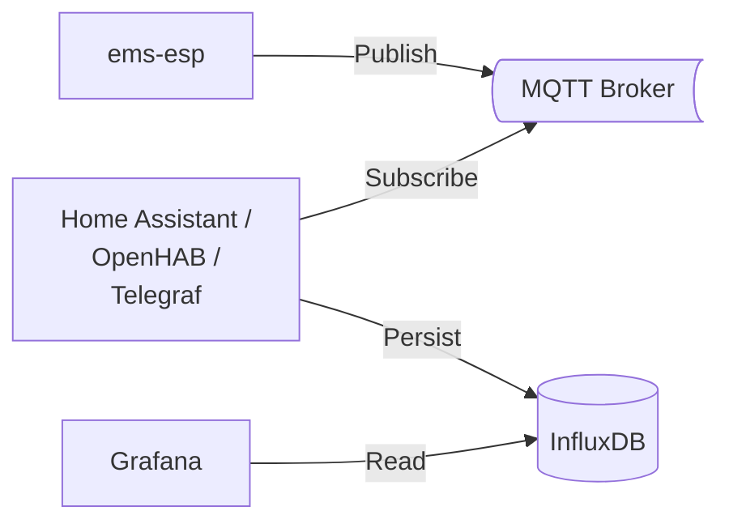

The open-source project [EMS-ESP](https://emsesp.org) connects your heat pump to your local network via the EMS bus.
With an EMS-ESP gateway, you can read measured values and, depending on the entity, change settings or execute commands.
If you do not want to build the hardware yourself, you can purchase hardware already flashed with _ems-esp_ from [BBQKees](https://bbqkees-electronics.nl/?lang=de).
I decided on the [ BBQKees Gateway E32 V2.2](https://bbqkees-electronics.nl/product/gateway-e32-v2-ethernet-wifi-ausgabe-v2-kit/?lang=de).

## Installation

The easiest way to connect the _ems-esp_ gateway to your heat pump is via the service socket.
In my Bosch CS 6800i AW 12 MB, the service socket is located on the left side of the electronics box.
To do this, open the front panel of the indoor unit by removing the screw on the top and pressing the two locking buttons.
To access the service socket, loosen the screw at the top and fold out the gray electronics box.
Then first connect the cable to the _ems-esp_ gateway and, in the next step, plug the cable into the service socket (exactly in this order).
You can then reassemble everything and route the cable through the small recess at the top left between the front panel and the housing.

<figure class="half">
  <a href="https://i.ibb.co/hFFtpd81/BBQKees-Gateway-E32-V2-2.jpg">
    
  </a>
  <a href="/assets/images/Servicebuchse.jpg">
    
  </a>
</figure>

To avoid sporadic connection problems, you should use a high-quality connection cable and keep the gateway outside the indoor unit.

## Setup

As soon as the gateway is connected to your heat pump, it starts automatically and opens a Wi-Fi network named _'ems-esp'_.
Connect your computer or smartphone to this Wi-Fi network.
If you then open the address [http://192.168.4.1](http://192.168.4.1) in your browser, the _ems-esp_ web interface appears.
The default login credentials are _'admin'_ with the password _'admin'_.

[](/assets/images/EMS-ESP.png)

You must now configure your home Wi-Fi under [Settings &rarr; Network](http://ems-esp/settings/network/settings).
You can then switch your computer/smartphone back to your home Wi-Fi.

Your _ems-esp_ gateway should now be accessible at [http://ems-esp](http://ems-esp) or [http://ems-esp.local](http://ems-esp.local).
You can access the REST API at `/api`:

```shell
curl http://ems-esp/api/thermostat/manualtemp
> {"name":"manualtemp","fullname":"HK1 manuelle Temperatur","circuit":"hc1","value":21.5,"type":"number","min":0,"max":127,"uom":"°C","readable":true,"writeable":true,"visible":true}
```

## Reading/setting entities

In the web interface, your heat pump appears with 3 devices:

- **XCU_THH/CS\*800i, Logatherm WLW\*** (Boiler): the heat pump control \
  The boiler controls all important functions of the heat pump and offers most of the entities.
- **HMI800.2/Rego 3000, UI800, Logamatic BC400** (Thermostat): the control panel on the indoor unit \
  The thermostat is essentially responsible for determining the flow temperature and a few other settings.
- **K30RF/WiFi module** (Gateway Module): optional Wi-Fi module for connecting the Bosch/Buderus app

The entities that can be read from the devices are either measured values (e.g. flow temperature), status information (e.g. domestic hot water production active), settings (e.g. desired room temperature), or commands (e.g. start disinfection).
In my [entity overview](/en/docs/smarthome/entities/), you will find a list with explanations of the most important entities.

You can now get started and view and configure the entities via the web interface.
And via the REST API, you can connect the following extensions:

- [Notifications](/en/docs/smarthome/notifications/) to be informed about compressor activity or the use of the electric backup heater via push notification on your smartphone
- Retrieve live data directly via the REST API from _ems-esp_ and visualize it in [Grafana](/en/docs/smarthome/grafana/)
- Connect energy management systems such as [evcc](/en/docs/smarthome/evcc/)
- Use [Gen-AI](/en/docs/smarthome/ai/) applications such as Anthropic Claude to evaluate your entities.

The next section explains how to connect smart home systems via MQTT.

## MQTT

MQTT is suitable for exchanging data between _ems-esp_ and a smart home system.
For this, you need an MQTT broker such as [Mosquitto](https://mosquitto.org/), which is already provided as an optional extension in many smart home systems.
In Home Assistant and OpenHAB, Mosquitto can easily be installed via the corresponding [add-on](https://github.com/home-assistant/addons/blob/master/mosquitto/DOCS.md).
Communication with _evcc_ works via the REST API of _ems-esp_.
Therefore, you do not need MQTT for _evcc_.



To make _ems-esp_ send the measured values to the MQTT broker, you must enable this under _Settings &rarr; MQTT&nbsp;Settings_ and enter the _Broker Address_, as well as the _Username_ and _Password_.
You should also enable _Enable MQTT Discovery_, because otherwise you have to create all entities manually.

[](/assets/images/EMS-ESP-MQTT.png)

If you do not have an MQTT broker yet, communication will of course only work once you have installed the MQTT add-on for your smart home.
More information can be found in the following sections:

- [Home Assistant](/en/docs/smarthome/home-assistant/)
- [OpenHAB](/en/docs/smarthome/openhab/)
- [Grafana](/en/docs/smarthome/grafana/)
